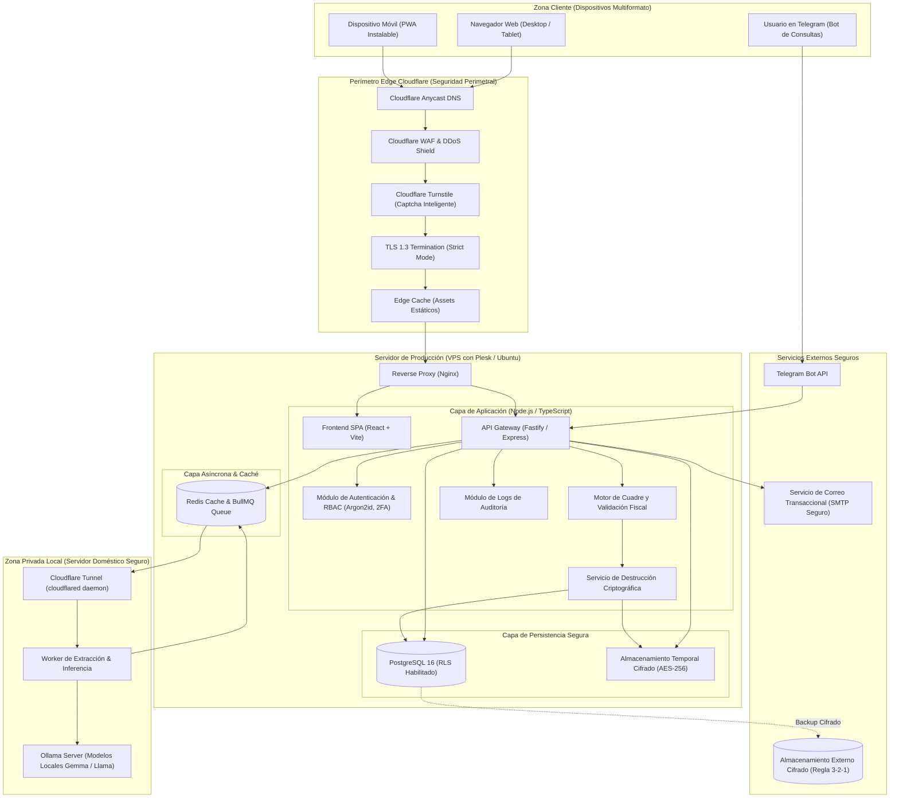
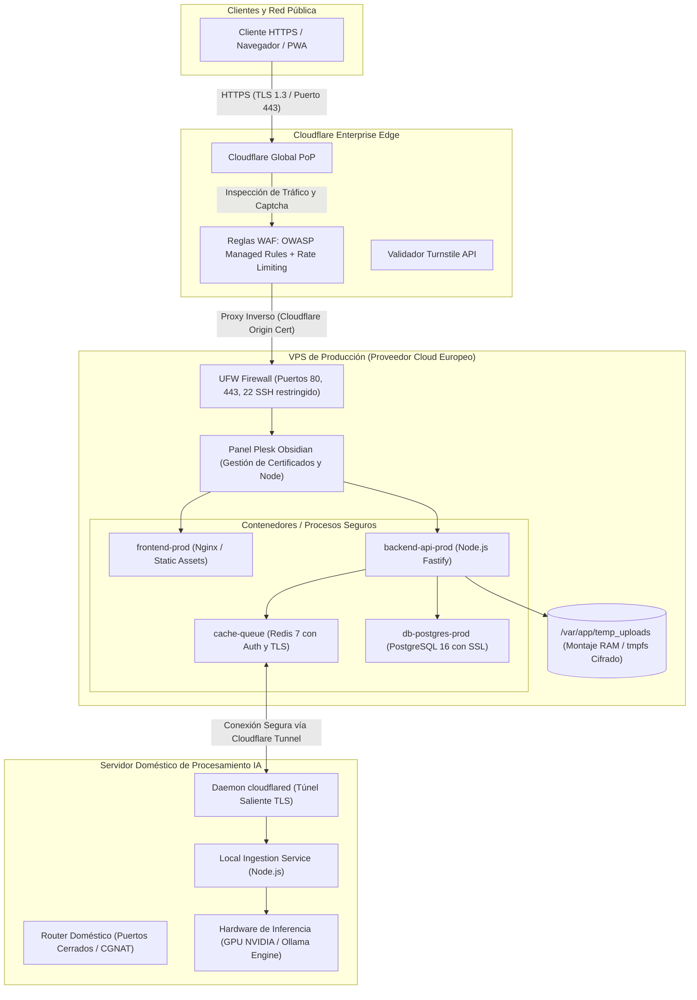
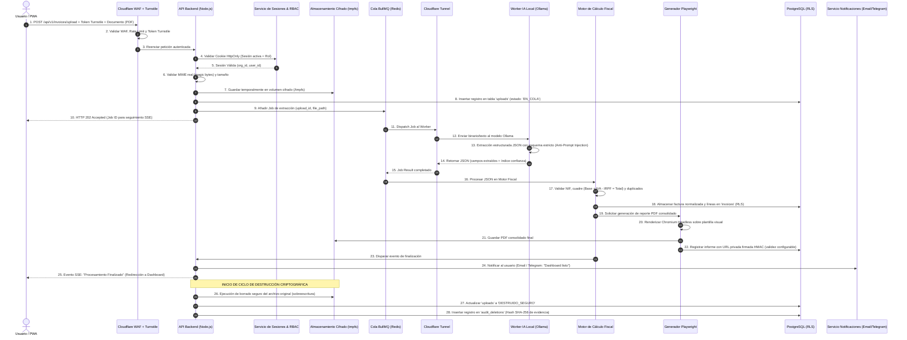
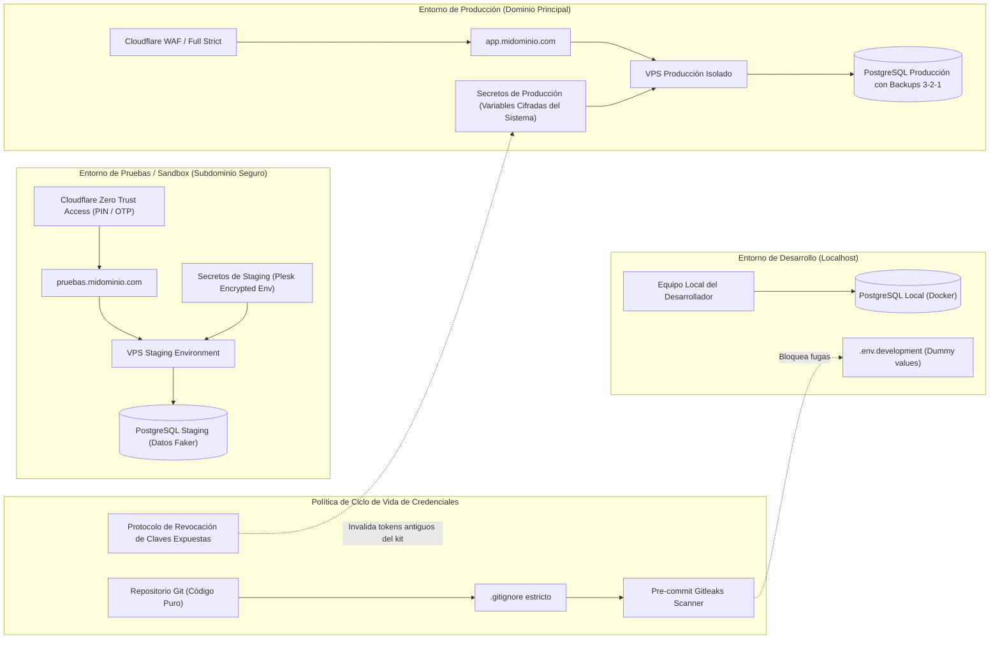
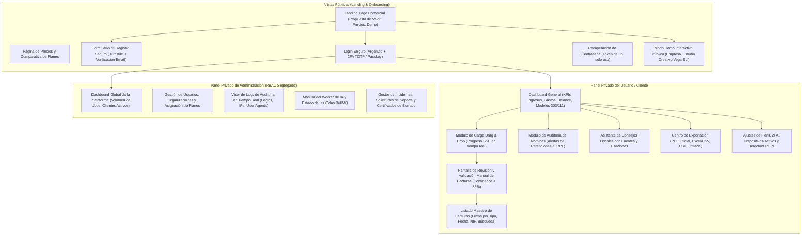

# PROYECTO FINAL 2º DAW: DASHBOARD DE FACTURACIONES Y NÓMINAS
## FASE 1: ANÁLISIS DE REQUISITOS, SISTEMA DE DISEÑO Y ARQUITECTURA TÉCNICA DEL SISTEMA
**Autor:** Carlos Plata Morán  
**Especialidad:** Desarrollo de Aplicaciones Web (2º DAW) — Curso 2026/2027  
**Proyecto:** *Dashboard de Facturaciones — "Tus facturas, organizadas solas"*  
**Fecha de Entrega de Fase 1:** Octubre 2026  
**Documento:** Memoria de Análisis, Arquitectura de Software y Especificación UX/UI (Fase 1)

---

## 1. RESUMEN EJECUTIVO / EXECUTIVE SUMMARY

### 1.1 Resumen en Español
El proyecto **Dashboard de Facturaciones** es una solución web progresiva (PWA) y SaaS diseñada para automatizar íntegramente el ciclo de recepción, digitalización, extracción inteligente, auditoría contable/fiscal y visualización interactiva de facturas y nóminas de autónomos y pequeñas empresas españolas. 

Partiendo de un prototipo previo basado en scripts locales de Claude Code sin persistencia ni seguridad formal, este proyecto evoluciona hacia una arquitectura empresarial de tres capas protegida por el perímetro de **Cloudflare (WAF, DNS, Turnstile, SSL Full Strict)**. Incorpora un backend desacoplado en **Node.js/TypeScript**, una base de datos relacional **PostgreSQL con Seguridad a Nivel de Fila (RLS)**, un pipeline asíncrono con **BullMQ/Redis**, y un worker de Inteligencia Artificial que procesa documentos de forma 100% privada en un servidor doméstico mediante **Ollama** interconectado a través de un túnel seguro **Cloudflare Tunnel (Zero Trust)**, evitando la exposición de puertos o la transferencia internacional de datos fiscales. 

El sistema resuelve las deficiencias detectadas en la defensa previa: implementa autenticación robusta con **Argon2id, 2FA (TOTP) y WebAuthn**, control de acceso basado en roles (**RBAC** con paneles segregados de usuario y administrador), política demostrable de **destrucción segura de documentos originales** bajo el principio de minimización del RGPD, auditoría contable (modelos 303, 111, 130), y preparación estructural para la normativa **VERI*FACTU** (RD 1007/2023) y la **Ley Crea y Crece**.

### 1.2 Executive Summary (English)
*The **Invoice Dashboard** project is an enterprise-grade Progressive Web Application (PWA) and SaaS platform engineered to fully automate the intake, OCR data extraction, accounting audit, and interactive analytics of invoices and payslips for Spanish freelancers and SMBs. Evolving from an early single-user script prototype, this release establishes a robust multi-tenant architecture safeguarded by a **Cloudflare Edge perimeter (WAF, Turnstile Captcha, TLS 1.3 Full Strict)**.*

*The stack combines a **Node.js/TypeScript** REST API with a **PostgreSQL** relational database enforcing strict **Row-Level Security (RLS)**. Heavy AI workloads are offloaded via a **BullMQ/Redis** asynchronous queue to a private on-premise AI worker running **Ollama**, tethered through an encrypted **Cloudflare Tunnel (Zero Trust)** to guarantee zero data leakage and compliance with European GDPR data sovereignty. Key deliverables include NIST SP 800-63B compliant authentication with **Argon2id, 2FA TOTP**, automated cryptographic file shredding, tax validation engines (Spanish VAT Form 303, Personal Income Tax withholding Forms 111/130), and forward compatibility with the upcoming Spanish **VERI*FACTU** and electronic invoicing mandates.*

---

## 2. ANÁLISIS DE LA SITUACIÓN DE PARTIDA Y RESOLUCIÓN DE DEBILIDADES

El proyecto hereda la base conceptual del kit experimental previo (`04-dashboard-facturas.md`, `CLAUDE.md`, `dashboard-facturacion.html`). Dicho prototipo demostró viabilidad en la extracción mediante prompts de IA, pero presentaba vulnerabilidades y carencias críticas que impedían su validación en un entorno de producción y ante el tribunal de 2º DAW:

| Debilidad Identificada en Proyecto Previo | Riesgo Técnico / Legal | Solución Implementada en esta Arquitectura |
| :--- | :--- | :--- |
| **Ausencia de Base de Datos Real** | Los datos se almacenaban en un archivo JSON plano local (`facturas_datos.json`). Imposible concurrencia, transaccionalidad ACID ni multitenencia. | Base de datos relacional **PostgreSQL 16** con integridad referencial, transacciones ACID y **Row-Level Security (RLS)** por organización. |
| **Autenticación Inexistente** | El panel HTML se abría en local o se distribuía por email sin control de acceso ni sesiones. | Sistema completo de autenticación: registro con doble confirmación de email, hashing **Argon2id**, **2FA TOTP (RFC 6238)** obligatorio, rate limiting por IP/cuenta y sesiones en cookies `HttpOnly; Secure; SameSite=Strict`. |
| **Exposición de Credenciales** | Tokens de APIs (EmailJS, OpenRouter) presentes en texto claro en archivos de trabajo (`token.env`) y capturas. | **Plan de revocación y saneamiento inmediato**: revocación en paneles de proveedores, filtrado por `.gitignore`, inyección dinámica en tiempo de ejecución mediante gestor de secretos y escaneo con `gitleaks`. |
| **Inseguridad en el Transporte y Red** | Conexión directa a puertos locales o hosting estático sin cortafuegos de aplicación web. | Perímetro **Cloudflare WAF**, forzado de HTTPS con **TLS 1.3**, HSTS con Preload, cabeceras de seguridad estrictas (CSP, frame-ancestors) y conexión a IA local por **Cloudflare Tunnel cifrado**. |
| **Falta de Segregación de Roles** | No existía diferenciación entre el usuario cliente y el administrador del sistema. | **RBAC (Role-Based Access Control)** gestionado exclusivamente en servidor: roles `user`, `admin` y `auditor` en tabla separada, con paneles y rutas de API estrictamente disjuntas. |
| **Conflicto Legal de Privacidad vs Conservación** | Se afirmaba "no persistencia", pero sin mecanismo auditable ni encaje con la Ley General Tributaria. | Definición contractual de la plataforma como **Encargado del Tratamiento (art. 28 RGPD)**: borrado criptográfico programado del fichero temporal con log de destrucción (hash SHA-256) y entrega de paquete consolidado al cliente (Responsable). |

---

## 3. CATÁLOGO DE REQUISITOS DEL SISTEMA

### 3.1 Requisitos Funcionales (RF)

#### Módulo de Autenticación y Control de Accesos
- **RF-01 (Registro de Usuarios):** Registro mediante email corporativo/personal, contraseña robusta y validación obligatoria de Cloudflare Turnstile. Envío de token de verificación temporal firmado (validez 15 minutos).
- **RF-02 (Políticas de Contraseña NIST SP 800-63B):** Longitud mínima de 12 caracteres, comprobación asíncrona contra base de datos de contraseñas vulneradas (HaveIBeenPwned API vía k-Anonymity) y prohibición de restricciones arbitrarias (truncado, prohibición de caracteres especiales).
- **RF-03 (Autenticación de Dos Factores - 2FA):** Implementación de TOTP conforme a RFC 6238 con generación de secreto en Base32, visualización de código QR y entrega de 8 códigos de recuperación de un solo uso hasheados con SHA-256. Opción WebAuthn/Passkeys para autenticación biométrica en dispositivos compatibles.
- **RF-04 (Gestión de Sesiones Seguras):** Emisión de tokens de sesión mediante cookies HTTP-Only, Secure, SameSite=Strict con rotación en cada inicio de sesión y revocación global ("Cerrar sesión en todos los dispositivos").
- **RF-05 (Control de Acceso Basado en Roles - RBAC):** Segregación estricta entre Panel de Usuario (gestión de facturas, suscripción, perfil, logs propios) y Panel de Administración (métricas globales, control de planes, auditoría de accesos, gestión de incidencias).

#### Módulo de Ingesta, Extracción y Procesamiento IA
- **RF-06 (Subida Segura de Documentos):** Área interactiva Drag & Drop con soporte para PDF (facturas tradicionales y nóminas), imágenes (PNG, JPG, TIFF) y XML estándar Facturae 3.2.2. Validación de firmas binarias (*magic bytes*) y escaneo antivirus previo.
- **RF-07 (Cola Asíncrona de Extracción):** Encolado de trabajos en BullMQ/Redis con reporte de progreso en tiempo real mediante Server-Sent Events (SSE) o WebSockets (estados: *Subido -> Validado -> En Cola -> Extrayendo IA -> Auditando Fiscalmente -> Generado -> Finalizado*).
- **RF-08 (Extracción con IA Local Privada):** Procesamiento del documento mediante worker local con Ollama (modelo Gemma 2/4 / Llama 3 optimizado con prompts estructurados y formato JSON schema). Extracción de campos: emisor (NIF, nombre), receptor (NIF, nombre), número de factura, fecha de emisión/operación, base imponible, desglose de tipos de IVA, retención de IRPF y total.
- **RF-09 (Puntuación de Confianza y Revisión Manual):** Cálculo de un índice de confianza por campo ($0-100\%$). Si la confianza de un campo crítico es menor al $85\%$, el documento se marca para "Revisión Manual Requerida" con interfaz visual de corrección lado a lado.
- **RF-10 (Auditoría Inteligente de Nóminas):** Detección de base de cotización, contingencias comunes, contingencias profesionales, retención de IRPF aplicada según tramo salarial y cálculo de alertas por posibles desajustes en el convenio o retenciones anómalas.

#### Módulo Fiscal y Analítico
- **RF-11 (Motor de Validación Fiscal Española):** Comprobación matemática estricta: $\text{Base Imponible} + \sum \text{Cuotas IVA} - \text{Retención IRPF} = \text{Total Factura}$. Validación algorítmica de NIF/NIE/CIF conforme a los algoritmos de control oficiales de la AEAT. Detección automática de facturas duplicadas (mismo emisor + número de factura + fecha).
- **RF-12 (Liquidación Trimestral Automatizada):** Agregación de datos fiscales para la preparación de los borradores del **Modelo 303** (IVA repercutido vs IVA soportado deducible) y **Modelo 111 / 130** (retenciones de profesionales y pagos fraccionados).
- **RF-13 (Dashboard Financiero Interactivo):** Gráficos dinámicos de ingresos vs gastos, evolución mensual, margen de beneficio neto, balance de tesorería, ranking de clientes por volumen de facturación y concentración de riesgo crediticio.
- **RF-14 (Generación de Informes y URL Firmada):** Exportación de informe ejecutivo en PDF de alta fidelidad renderizado mediante Chromium headless. Generación de enlaces web temporales protegidos por token criptográfico HMAC-SHA256 con fecha de caducidad configurable (24h, 7 días, 30 días) y opción de contraseña.

#### Módulo de Privacidad y Destrucción de Datos
- **RF-15 (Ciclo de Borrado Automático Demostrable):** Tras la generación satisfactoria del dashboard y descarga del paquete por el cliente, ejecución de un cronjob de sobreescritura segura del archivo binario temporal y registro de una entrada inmutable en la tabla `audit_deletions` que acredita fecha, hora, identificador anónimo y hash SHA-256 del fichero destruido.
- **RF-16 (Portal de Ejercicio de Derechos RGPD):** Opciones directas para el usuario de "Descargar todos mis datos en formato JSON/ZIP (Portabilidad)" y "Eliminar definitivamente mi cuenta y todos los registros asociados (Derecho al Olvido)".

---

### 3.2 Requisitos No Funcionales (RNF)

- **RNF-01 (Seguridad en Transporte):** Obligatoriedad estricta de TLS 1.3 / TLS 1.2. Desactivación de suites criptográficas obsoletas. Calificación mínima **A+ en SSL Labs**.
- **RNF-02 (Resistencia contra Vulnerabilidades Web):** Cumplimiento íntegro de **OWASP ASVS v4.0 Nivel 2**. Protección estricta contra SQL Injection (consultas parametrizadas al 100%), XSS (Content-Security-Policy restrictiva, saneamiento de DOM), CSRF (SameSite cookies + Double Submit Token para APIs no idempotentes) y SSRF (aislamiento de red del worker).
- **RNF-03 (Defensa ante Ataques de IA / LLM):** Aplicación del **OWASP Top 10 for LLM Applications**. Los documentos analizados se tratan como entradas potencialmente maliciosas (ataques de prompt injection indirecto). El prompt del sistema fuerza formato JSON estructurado y rechaza cualquier instrucción embebida en el cuerpo de las facturas.
- **RNF-04 (Rendimiento y Core Web Vitals):** 
  - Largest Contentful Paint (LCP) $< 2.0$ segundos.
  - Interaction to Next Paint (INP) $< 150$ milisegundos.
  - Cumulative Layout Shift (CLS) $< 0.05$.
- **RNF-05 (Disponibilidad y Tolerancia a Fallos):** Tasa de disponibilidad objetivo del $99.9\%$. Desacoplamiento mediante colas para que caídas puntuales del worker de IA local no provoquen la denegación del servicio web (los trabajos quedan retenidos y reintentados automáticamente con backoff exponencial).
- **RNF-06 (Accesibilidad y Usabilidad):** Cumplimiento de las directrices **WCAG 2.2 Nivel AA** conforme al mandato de la Ley Europea de Accesibilidad (Directiva UE 2019/882). Ratios de contraste de color $\ge 4.5:1$ en texto normal y $\ge 3:1$ en elementos gráficos/UI.
- **RNF-07 (Internacionalización - i18n):** Soporte bilingüe integral (Español / Inglés) en todas las interfaces de usuario, mensajes de error, emails transaccionales y reportes PDF exportados.

---

## 4. JUSTIFICACIÓN DE DECISIONES TÉCNICAS Y COMPARATIVA DE ARQUITECTURA

Para cada componente crítico del sistema se evalúan dos alternativas técnicas principales, detallando pros, contras y justificando la elección adoptada ante el tribunal de 2º DAW.

### 4.1 Arquitectura del Frontend: SPA React + Vite + Tailwind vs Next.js SSR

```
Opciones Evaluadas:
1. React 18+ (SPA) con TypeScript, Vite, Tailwind CSS y Zustand (Elegida por Defecto)
2. Next.js 14+ (App Router con Server-Side Rendering)
```

| Criterio de Comparación | Opción 1: React + Vite + Tailwind (Elegida) | Opción 2: Next.js SSR / App Router |
| :--- | :--- | :--- |
| **Arquitectura y Despliegue** | Cliente desacoplado alojado en Cloudflare Pages / Nginx estático. Cero sobrecarga de Node en renderizado. | Requiere servidor Node.js permanente para SSR o adaptación compleja en Vercel/Node standalone. |
| **Idoneidad para Dashboard** | Óptima: los dashboards son aplicaciones altamente interactivas impulsadas por estados de cliente, gráficos dinámicos y eventos en tiempo real. | Subóptima: el valor de SSR es mínimo en un panel protegido tras login donde el SEO no aplica. |
| **Capacidades Offline / PWA** | Soporte PWA directo y transparente con Service Workers y cacheo de shell estático para consulta sin conexión. | Mayor complejidad de configuración para modo offline debido al renderizado híbrido en servidor. |
| **Separación de Responsabilidades** | Frontera clara: frontend puramente visual que consume una API REST/JSON estandarizada. | Mezcla lógica de servidor y cliente en los mismos ficheros (`Server Components`), dificultando auditorías de seguridad independientes. |

> **Justificación Técnica:** Se adopta **React + Vite + Tailwind CSS**. El dashboard es una herramienta analítica privada tras autenticación; no requiere indexación por motores de búsqueda (SEO). Una SPA estática servida desde el CDN de Cloudflare proporciona tiempos de carga inicial casi instantáneos (LCP < 1.2s), reduce la superficie de ataque del servidor y simplifica el soporte PWA para uso offline de autónomos en movilidad.

---

### 4.2 Backend y API: Node.js/TypeScript (Fastify) vs Python FastAPI

```
Opciones Evaluadas:
1. Node.js con TypeScript y Fastify / Express modular (Elegida por Defecto)
2. Python con FastAPI y SQLAlchemy
```

| Criterio de Comparación | Opción 1: Node.js / Fastify (Elegida) | Opción 2: Python / FastAPI |
| :--- | :--- | :--- |
| **Unificación de Lenguaje** | **Full-Stack TypeScript**: tipos de datos compartidos entre frontend, esquemas de validación Zod y backend. | Bifurcación tecnológica (JS/TS en cliente, Python en servidor), duplicando interfaces y contratos de datos. |
| **Rendimiento de E/S** | Fastify lidera los benchmarks de rendimiento en I/O con bajo consumo de CPU y memoria mediante parsing rápido de JSON. | Rendimiento excelente con ASGI (Uvicorn), pero mayor consumo de memoria base en entornos VPS limitados. |
| **Ecosistema de Colas y Workers** | **BullMQ**: integración nativa e hiperoptimizada sobre Redis con gestión visual de trabajos, reintentos y eventos. | Celery / RQ: robusto pero configuración más pesada y dependiente de librerías heterogéneas. |
| **Integración con IA** | Cliente HTTP tipado hacia Ollama / APIs de IA. La inferencia real se delega al motor de Ollama (C++/CUDA). | Facilidad para librerías nativas de ML (PyTorch/Transformers), innecesario al consumir modelos ya empaquetados en Ollama. |

> **Justificación Técnica:** Se elige **Node.js con TypeScript (Fastify)**. Permite compartir contratos de datos y esquemas de validación (Zod) entre cliente y servidor con tipado estricto extremo, reduciendo drásticamente los errores en tiempo de ejecución. La gestión de colas de trabajo con BullMQ es el estándar de la industria para microservicios asíncronos en Node.

---

### 4.3 Base de Datos y Persistencia: PostgreSQL con RLS vs MongoDB NoSQL

```
Opciones Evaluadas:
1. PostgreSQL 16 con Row-Level Security (RLS) y JSONB (Elegida por Defecto)
2. MongoDB / Motor NoSQL orientado a documentos
```

| Criterio de Comparación | Opción 1: PostgreSQL 16 con RLS (Elegida) | Opción 2: MongoDB (NoSQL) |
| :--- | :--- | :--- |
| **Integridad Transaccional** | Cumplimiento **ACID estricto**: fundamental para operaciones contables, facturas y auditorías financieras. | Transacciones multi-documento disponibles pero más costosas computacionalmente; consistencia eventual por defecto. |
| **Seguridad a Nivel de Fila** | **Row-Level Security (RLS)** nativo en el motor: un fallo en el código de la API no puede filtrar datos de otra empresa. | La seguridad depende exclusivamente de las cláusulas `where` programadas en la capa de aplicación. |
| **Precisión Numérica** | Tipos `NUMERIC(12,2)` para cálculo exacto de centavos de euro sin fallos de coma flotante binaria (IEEE 754). | Almacenamiento BSON numérico (Double por defecto); riesgo de desajustes en cálculos de céntimos si no se fuerza Decimal128. |
| **Flexibilidad de Esquema** | Columnas `JSONB` indexadas para metadatos heterogéneos de facturas + tablas relacionales para estructura fija. | Esquema dinámico total, pero sin garantías formales de clave foránea entre organizaciones y usuarios. |

> **Justificación Técnica:** Se adopta **PostgreSQL 16**. En software fiscal y contable, la integridad de los datos monetarios es innegociable. RLS proporciona una defensa en profundidad (*Defense in Depth*): incluso ante una hipotética inyección de código o error en un endpoint, la base de datos bloquea el acceso a filas que no pertenezcan a la organización del usuario autenticado.

---

### 4.4 Canal Seguro con la IA Local: Cloudflare Tunnel vs VPN WireGuard

```
Opciones Evaluadas:
1. Cloudflare Tunnel (Zero Trust / cloudflared) (Elegida por Defecto)
2. VPN WireGuard punto a punto (VPS a Servidor Local)
```

| Criterio de Comparación | Opción 1: Cloudflare Tunnel (Elegida) | Opción 2: VPN WireGuard |
| :--- | :--- | :--- |
| **Exposición de Red** | **Cero puertos abiertos** en el router residencial. Tráfico saliente cifrado sobre TLS hacia el Edge de Cloudflare. | Requiere abrir y redirigir un puerto UDP en el router de casa o mantener un servidor de enlace en el VPS. |
| **Compatibilidad CGNAT** | $100\%$ transparente ante operadores de fibra que utilizan CGNAT residencial sin IP pública fija. | Problemas de conectividad si el operador aplica CGNAT estricto en la conexión doméstica. |
| **Autenticación en el Edge** | **Service Tokens** de Cloudflare Access: validación en los servidores proxy antes de enrutar tráfico al túnel. | Autenticación criptográfica por pares de claves públicas/privadas de WireGuard. |
| **Mantenimiento y Resiliencia** | Daemon ligero `cloudflared` con reconexión automática instantánea ante cortes de fibra o cambios de IP. | Requiere monitorización de la interfaz de red, scripts de keepalive y gestión manual de rutas IP. |

> **Justificación Técnica:** Se selecciona **Cloudflare Tunnel (Zero Trust)**. Es la solución más segura y mantenible para conectar la API en el VPS con el servidor doméstico de Ollama. No expone ninguna IP ni puerto residencial a Internet, supera las limitaciones de CGNAT sin requerir IP fija, y aplica autenticación previa mediante Service Tokens en la red perimetral de Cloudflare.

---

### 4.5 Generación de Documentos PDF: Playwright Headless vs PDFKit

```
Opciones Evaluadas:
1. Chromium Headless mediante Playwright (Elegida por Defecto)
2. Generación programática directa con PDFKit / jsPDF
```

| Criterio de Comparación | Opción 1: Playwright Headless (Elegida) | Opción 2: PDFKit / jsPDF |
| :--- | :--- | :--- |
| **Fidelidad de Diseño** | **Identidad 1:1**: renderiza exactamente el mismo HTML/CSS/SVG del dashboard con soporte de tipografía web y CSS Grid. | Requiere dibujar cada caja, texto y línea calculando coordenadas cartesianas $(x, y)$ a mano. |
| **Mantenimiento** | Cualquier ajuste en el diseño visual de la interfaz se propaga automáticamente a la plantilla del PDF. | Cualquier cambio de diseño exige reescribir cientos de líneas de código imperativo de bajo nivel. |
| **Consumo de Recursos** | Requiere instanciar un proceso de Chromium (aprox. 80-120 MB RAM en el worker de cola). | Consumo ínfimo de memoria y CPU (procesamiento directo en JavaScript). |

> **Justificación Técnica:** Se implementa **Chromium Headless vía Playwright**. El objetivo del producto es entregar al cliente un informe visualmente impecable y profesional. El coste en memoria queda aislado en el worker de BullMQ, garantizando que el diseño del PDF sea idéntico al panel interactivo y soporte gráficos vectoriales SVG sin pérdida de resolución.

---

## 5. DIAGRAMAS DE ARQUITECTURA DEL SISTEMA (MERMAID)

### 5.1 Diagrama de Componentes Globales del Sistema



---

### 5.2 Diagrama de Despliegue de Infraestructura Física y Lógica



---

### 5.3 Diagrama de Secuencia E2E: Flujo "Subir Factura → Dashboard / PDF → Borrado"



---

### 5.4 Diagrama de Separación de Entornos y Gestión del Ciclo de Secretos



---

## 6. SISTEMA DE DISEÑO (DESIGN SYSTEM) Y ESPECIFICACIÓN UX/UI

### 6.1 Tokens de Diseño y Paleta Cromática Semántica
El diseño visual se articula en torno a la semántica fiscal y financiera, garantizando un reconocimiento cognitivo inmediato por parte del usuario:

| Token Semántico | Valor Hex (Light) | Valor Hex (Dark) | Ratio Contraste (WCAG) | Uso Obligatorio en la Aplicación |
| :--- | :--- | :--- | :--- | :--- |
| `--color-income-primary` | `#10B981` (Emerald 500) | `#34D399` (Emerald 400) | $4.8:1$ sobre fondo | Facturas emitidas, ingresos brutos, beneficios netos positivos. |
| `--color-income-surface` | `#ECFDF5` (Emerald 50) | `#064E3B` (Emerald 900) | $12.1:1$ con texto | Tarjetas de resumen de ingresos, chips de estado 'Cobrado'. |
| `--color-expense-primary`| `#EF4444` (Red 500) | `#F87171` (Red 400) | $4.6:1$ sobre fondo | Facturas de gasto recibidas, pérdidas, retenciones aplicadas. |
| `--color-expense-surface`| `#FEF2F2` (Red 50) | `#7F1D1D` (Red 900) | $11.8:1$ con texto | Tarjetas de gastos deducibles, avisos de alertas de discrepancia. |
| `--color-totals-primary` | `#3B82F6` (Blue 500) | `#60A5FA` (Blue 400) | $4.7:1$ sobre fondo | Balance acumulado, métricas globales, botones de acción primaria. |
| `--color-totals-surface` | `#EFF6FF` (Blue 50) | `#1E3A8A` (Blue 900) | $12.3:1$ con texto | Tarjetas de resumen fiscal del modelo 303/130, cabeceras. |
| `--color-bg-app` | `#F8FAFC` (Slate 50) | `#0F172A` (Slate 900) | N/A | Fondo global de la aplicación. |
| `--color-surface-card` | `#FFFFFF` (White) | `#1E293B` (Slate 800) | N/A | Contenedores de KPIs, tablas y módulos interactivos. |
| `--color-text-main` | `#0F172A` (Slate 900) | `#F8FAFC` (Slate 50) | $> 15:1$ | Tipografía de títulos y datos numéricos principales. |
| `--color-text-muted` | `#64748B` (Slate 500) | `#94A3B8` (Slate 400) | $> 4.6:1$ | Etiquetas secundarias, fechas y notas al pie. |

### 6.2 Tipografía y Jerarquía Visual
- **Familia Tipográfica Principal:** `Inter`, `-apple-system, BlinkMacSystemFont, 'Segoe UI', Roboto, sans-serif`.
- **Familia Tipográfica Numérica / Monedero:** `JetBrains Mono` o variantes tabulares de Inter (`font-variant-numeric: tabular-nums`) para evitar oscilaciones visuales al ordenar columnas monetarias en tablas.
- **Escala Modular:**
  - Display (KPI Total): `2.25rem` ($36\text{px}$) — `font-bold` (700)
  - Encabezado 1 (Títulos de Módulo): `1.5rem` ($24\text{px}$) — `font-semibold` (600)
  - Encabezado 2 (Subtítulos de Tarjeta): `1.125rem` ($18\text{px}$) — `font-medium` (500)
  - Cuerpo de Texto (Labels, tablas): `0.875rem` ($14\text{px}$) — `font-normal` (400)
  - Texto Auxiliar / Metadatos: `0.75rem` ($12\text{px}$) — `font-normal` (400)

### 6.3 Arquitectura de Pantallas y Wireframes del Sistema



---

## 7. POLÍTICA DE SEGURIDAD, GESTIÓN DE SECRETOS Y REVOCACIÓN FORENSE

### 7.1 Protocolo de Revocación de Secretos del Proyecto Heredado
Durante la auditoría del kit anterior se detectó la presencia del archivo `token.env` con claves de API en texto plano. Se establece de forma inmediata el siguiente protocolo de remediación:

1. **Invocación de Revocación de Claves:**
   - Revocación inmediata del token de OpenRouter en `openrouter.ai/keys`.
   - Revocación del identificador y clave privada del servicio EmailJS en `dashboard.emailjs.com`.
   - Regeneración del token de bot en `BotFather` de Telegram.
2. **Saneamiento del Historial Git:**
   - Exclusión irrevocable mediante regla `.gitignore`:
     ```gitignore
     # Secretos y credenciales de entorno
     .env
     .env.*
     !.env.example
     token.env
     *.pem
     *.key
     id_rsa
     ```
   - Instalación de pre-commit hook con `gitleaks` para auditar firmas de claves privadas y tokens antes de cualquier commit local.
3. **Gestión de Secretos en Producción:**
   - En el servidor de producción Plesk / VPS, las variables no se almacenan en ficheros dentro del árbol web; se inyectan directamente en el entorno de ejecución de systemd / Docker Secrets con permisos `chmod 600` restringidos al usuario de servicio sin privilegios `www-data` / `app-runner`.

---

## 8. PLAN DE ENTREGABLES POR FASES Y METODOLOGÍA DE DESARROLLO

Siguiendo el marco metodológico exigido para el ciclo de 2º DAW, el desarrollo se divide en 8 fases secuenciales auditables:

| Fase | Título y Alcance | Entregables Principales | Estado |
| :---: | :--- | :--- | :---: |
| **Fase 1** | **Análisis de Requisitos, Prototipos y Arquitectura** | Documento maestro de arquitectura, diagramas Mermaid, tokens del Design System y especificación de interfaces. | **COMPLETADA** |
| **Fase 2** | **Base de Datos, Autenticación, 2FA, Captcha y RBAC** | Scripts DDL PostgreSQL con RLS, endpoints de Auth en Node/TypeScript, lógica TOTP y suite de tests unitarios/integración. | Siguiente |
| **Fase 3** | **Ingesta, Worker de IA, Motor Fiscal y Dashboard** | Pipeline BullMQ, integración con Ollama local por Cloudflare Tunnel, motor de cuadre fiscal y frontend interactivo. | Pendiente |
| **Fase 4** | **Seguridad Avanzada, WAF, Certificados y Borrado Seguro** | Configuración de cabeceras HTTP, políticas Cloudflare WAF, servicio de destrucción criptográfica y reporte de seguridad A+. | Pendiente |
| **Fase 5** | **Sandbox, Pruebas Automatizadas y CI/CD** | Modo Demo público ("Estudio Creativo Vega SL"), entorno Staging, tests E2E Playwright y GitHub Actions. | Pendiente |
| **Fase 6** | **Suscripciones, Notificaciones n8n/Telegram, PWA e i18n** | Checkout Stripe/Paddle, workflows n8n, soporte offline PWA y diccionarios bilingües ES/EN. | Pendiente |
| **Fase 7** | **Marco Legal RGPD/EIPD, Accesibilidad y Rendimiento** | Contrato de encargado del tratamiento, EIPD, auditoría WCAG 2.2 AA y optimización Core Web Vitals. | Pendiente |
| **Fase 8** | **Documentación Final, Manuales y Material de Venta** | Memoria técnica completa, manual de usuario/admin, presentación de defensa con guion y pitch comercial. | Pendiente |

---

## 9. LISTA DE COMPROBACIÓN (CHECKLIST) DE LA FASE 1

- [x] Resumen ejecutivo en español y en inglés (*Summary in English*).
- [x] Diagnóstico de debilidades del proyecto del año anterior y soluciones adoptadas.
- [x] Catálogo detallado de Requisitos Funcionales (RF-01 al RF-16).
- [x] Catálogo detallado de Requisitos No Funcionales (RNF-01 al RNF-07: OWASP ASVS v4.0 Nivel 2, NIST SP 800-63B, WCAG 2.2 AA).
- [x] Justificación técnica de decisiones con análisis de 2 alternativas y selección fundamentada para el tribunal de 2º DAW (Frontend, Backend, DB, Conexión IA Local, Generación PDF).
- [x] Diagrama de componentes globales del sistema en Mermaid.
- [x] Diagrama de despliegue de infraestructura física/lógica en Mermaid.
- [x] Diagrama de secuencia E2E completo (Subida $\to$ IA $\to$ Fiscal $\to$ PDF $\to$ Borrado) en Mermaid.
- [x] Diagrama de separación de entornos (Dev / Staging / Prod) y gestión del ciclo de secretos en Mermaid.
- [x] Especificación del Sistema de Diseño (Design System): tokens de color semántico (verde ingresos, rojo gastos, azul balances), tipografía y mapa de navegación de pantallas.
- [x] Protocolo de revocación forense de credenciales expuestas en el kit previo.
- [x] Cronograma de 8 fases operativas estructurado y preparado para ejecución.

